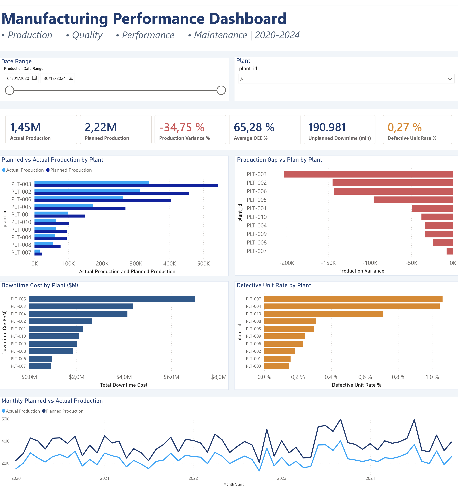

# Manufacturing Performance & KPI Dashboard

> **Portfolio project | PostgreSQL · SQL · Power Query · Power BI · DAX**

An end-to-end business intelligence project exploring manufacturing output, production-plan attainment, quality, downtime, and equipment effectiveness using a synthetic manufacturing dataset.

## Project at a glance

- **Dataset:** 3,000 records covering 2020–2024
- **Operational scope:** 10 plants, 36 production lines, 49 work centers
- **Data platform:** PostgreSQL
- **Preparation:** Power Query
- **Reporting and metrics:** Power BI and DAX

## Business question

How can manufacturing stakeholders monitor production performance, identify gaps against plan, understand quality and downtime patterns, and decide where to investigate operational losses?

The dashboard brings production, quality, downtime, and OEE indicators into one interactive report, with plant and date filters for focused analysis.

## Dashboard capabilities

- Actual versus planned production and production variance
- Production output by plant and production trends over time
- Downtime cost comparisons across plants
- Defect-rate comparisons by plant
- Unplanned downtime and average OEE KPIs
- Plant and date slicers for interactive exploration

## Dashboard Preview



## Technical workflow

### 1. Data modeling in PostgreSQL

Structured the manufacturing data into a schema with a production fact table and supporting dimensions for date, plant, line, product, shift, and work center. The dimensional model supports consistent analysis across operational entities.

### 2. Data preparation and validation

Used Power Query to combine production data with source fields and product keys, including downtime-category fields for focused investigation. Checked row counts and traced a category-level downtime discrepancy back to the source data.

### 3. KPI development in Power BI

Created DAX measures for actual production, planned production, production variance, defective units, defect rate, unplanned downtime, downtime cost, and average Overall Equipment Effectiveness (OEE).

### 4. Interactive reporting

Built a Power BI dashboard with KPI cards, comparative plant-level charts, a monthly production trend, and plant/date filters.

## Selected findings

The figures below are calculated from the project dataset and should be understood as **synthetic-data results**, not claims about a real manufacturer.

| Metric | Result |
|---|---:|
| Actual production | 1,448,365 units |
| Planned production | 2,219,673 units |
| Production variance vs. plan | -34.75% |
| Defective units | 3,944 |
| Defect rate | 0.27% |
| Unplanned downtime | 190,980.64 minutes |
| Calculated downtime cost | $28,340,112.58 |
| Average OEE | 65.28% |

At plant **PLT-004**, work center **WC-039** recorded 1,851.43 minutes of unplanned downtime. Of the six recorded downtime categories, mechanical downtime was largest at 918 minutes, approximately 55.4% of the categorized total.

## Data-quality note

For PLT-004 / WC-039, the six recorded downtime-category fields sum to 1,658.20 minutes, compared with 1,851.43 minutes of total unplanned downtime. This leaves an unreconciled difference of **193.23 minutes**.

The discrepancy was present in the source data and was not introduced by the Power Query merge. Category-level totals are therefore treated as recorded values, not as a complete reconciliation of total downtime.

## Recommendations

1. Investigate recurring mechanical downtime at WC-039 using maintenance logs and failure records.
2. Review electrical downtime as the next-largest recorded category.
3. Reconcile the 193.23-minute difference and review downtime-coding rules.
4. Investigate the production-plan gap before attributing it to any single cause.
5. Continue monitoring production, quality, downtime, and OEE over time.

## Repository structure

Suggested structure for publishing the project:

```text
manufacturing-performance-dashboard/
├── README.md
├── images/
│   └── manufacturing-performance-dashboard.png
├── sql/
│   └── schema-and-analysis.sql
├── powerbi/
│   └── manufacturing-performance-dashboard.pbix
└── docs/
    └── data-quality-notes.md
```

Only add files you actually have and are permitted to share. Do not publish credentials, connection strings, or confidential data. If the dataset is synthetic, state that clearly.

## Skills demonstrated

- Relational data modeling and SQL
- Data preparation and validation with Power Query
- DAX measure development
- KPI design and interactive dashboard development
- Manufacturing performance analysis
- Data-quality investigation and transparent reporting
- Translating analytical findings into actionable recommendations

## Limitations

- The dataset is synthetic.
- The downtime cost is a calculated project metric; it should not be represented as an audited financial figure.
- The observed production gap is a signal for investigation, not proof of a particular root cause.
- Downtime-category totals contain an identified unreconciled difference for PLT-004 / WC-039.
## License and Data Attribution

### Code and Documentation
The original SQL scripts and documentation in this repository are my own work, except where otherwise noted. The licensing terms are described in the repository's `LICENSE` file.

### Data Attribution

This project uses the MFG-005 Manufacturing Line Performance Dataset (Sample), provided by XpertSystems.ai via Hugging Face.

Source: https://huggingface.co/datasets/xpertsystems/mfg005-sample

Dataset license: CC BY-NC 4.0 (Creative Commons Attribution-NonCommercial 4.0 International).

The dataset is not my original work and is not included in this repository. Please review the original dataset license for its terms and restrictions. The MIT License in this repository applies only to my original work where I hold the necessary rights.

---
**Author:** Sunilkumar Labana
**Contact:** https://www.linkedin.com/in/sunilkumar-labana-data-analyst/
